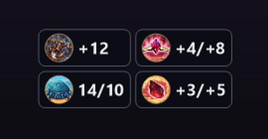

# Hearthstone SpeedUp

Ускоряет **бой в Полях сражений** и **проигрывание действий** в Hearthstone —
розыгрыш карт, атаки, срабатывания эффектов. Всё остальное идёт с обычной
скоростью: таблица соперников, существа в таверне, наведение на карты.

Скорости: **x1 · x2 · x3 · x8**. Подключается к игре сама.

Во второй вкладке — **подсказки по Полям сражений** поверх игры: ранги героев
и аксессуаров при выборе, сводка по своей доске и список прошлых игр.


> **Внимание.** Программа изменяет клиент игры. Правила Blizzard это
> запрещают, аккаунт может быть заблокирован. Используете на свой риск.

## Скачать и запустить

1. Скачайте [HearthstoneSpeedUp-v1.0.11.zip](https://github.com/PickaBoB/Hearthstone-SpeedUp/releases/download/v1.0.11/HearthstoneSpeedUp-v1.0.11.zip)
   или откройте [последний релиз](https://github.com/PickaBoB/Hearthstone-SpeedUp/releases/latest).
2. Распакуйте архив в отдельную папку. Оставьте вместе
   `HearthstoneSpeedUp.exe`, `gsunity64.dll` и папку `sim\` — она нужна для
   точного расчёта боёв.
3. Запустите `HearthstoneSpeedUp.exe` — до игры или после, неважно.
   Windows сразу запросит права администратора: они нужны для внедрения модуля
   и автореконнекта. .NET и Node.js устанавливать не нужно, всё уже внутри.
   Если игра уже была открыта при первом запуске программы, перезапустите её:
   оверлею нужен `Power.log`, а игра включает его запись только при запуске.
4. Дождитесь надписи «Подключено» и выберите скорость. Скорость можно
   переключать и прямо в игре: кнопки **x1 · x2 · x3 · x8** в правом нижнем
   углу (отключаются во вкладке «Поля сражений»).

Кнопка **↻** справа от скоростей — **автореконнект для пропуска боя**. Она
сбрасывает только соединение с сервером текущего матча и восстанавливает его
через 1 секунду, не затрагивая Battle.net. Во время ожидания на кнопке видно
`…`, при ошибке — красный `!`; подробность появится в статусе программы.
Пока поддерживается IPv4-подключение к игровому серверу.

Горячие клавиши (работают прямо из игры, переназначаются в окне — нажмите
сочетание на вкладке «Скорость» и затем новые клавиши):

| Клавиши    | Скорость |
| ---------- | -------- |
| Ctrl+Alt+1 | x1       |
| Ctrl+Alt+2 | x2       |
| Ctrl+Alt+3 | x3       |
| Ctrl+Alt+4 | x8       |

Строка «Сейчас» в окне показывает текущую скорость игры и что происходит:
«идёт действие» — ускорено, «простой, x1» — обычная скорость.

## Поля сражений

Вкладка «Поля сражений» читает `Power.log` игры и рисует поверх неё:

* **при выборе героя и аксессуаров** — ранг каждого варианта и среднее место
  по статистике [Firestone](https://www.firestoneapp.com) (данные качаются сами,
  срез по рейтингу выбирается в окне);
* **в таверне** — панель слева в стиле Hearthstone Deck Tracker: круглые
  иконки доступных и забаненных рас, начальный и текущий MMR, последние
  восемь игр текущей сессии;
  номер хода — отдельной плашкой в правом верхнем углу. Над монетами справа
  показываются ненулевые усиления нежити, заклинаний таверны, жуков,
  кровавых самоцветов, Номи и звукорегуляторов, золото на следующий ход и
  бесплатные обновления — с игровыми иконками и текущими значениями;
* **при наведении на портрет соперника** — сверху его аватар и последняя
  увиденная доска, а также все уровни таверны с ходами, на которых он их
  открыл; в дуэтах показываются обе доски команды;
* **между играми** — та же session-панель остаётся в меню: расы последнего
  лобби, начальный и текущий MMR и последние восемь игр с фоном героя,
  местом и изменением рейтинга.

### Примеры оверлея

**Усиления и ресурсы в таверне:**



Рейтинг Полей сражений игра никуда не пишет, поэтому он читается из памяти
клиента тем же модулем, что отвечает за ускорение: без него всё остальное
работает, но рейтинга и его изменений не будет.

Высоту меток и панели можно подогнать прямо в окне — игра у всех расположена
чуть по-разному.

## Частые вопросы

**Windows пишет «Система Windows защитила ваш компьютер».**
Программа не подписана сертификатом. Нажмите «Подробнее» → «Выполнить в
любом случае».

**Антивирус ругается или удаляет файл.**
Программа внедряет `gsunity64.dll` в процесс игры — антивирусы такое не
любят. Исходники открыты в этом репозитории, можно собрать самому
(см. ниже). Добавьте папку в исключения или не пользуйтесь.

**Пишет «Не удалось подключиться» или «Модули игры не читаются».**
Скорее всего, игра запущена от администратора. Запустите программу тоже от
администратора (правый клик → «Запуск от имени администратора»).

**Ускорение не включается.**
Перезапустите игру и программу. Если не помогло — приложите к
[issue](https://github.com/PickaBoB/Hearthstone-SpeedUp/issues) лог
`%TEMP%\gsunity_<номер процесса>.log` (вставьте `%TEMP%` в адресную строку
проводника).

**После патча Hearthstone перестало работать.**
Программа опирается на внутренние классы игры. Если Blizzard их
переименует, ускоряться будет всё подряд или ничего — в окне это будет
видно, а лог скажет, что именно не нашлось. Нужно обновление программы.

**Что не ускоряется.**
Всё, что считает сервер: таймер хода, награды, поиск матча. Ускоряется
только то, что клиент показывает.

**Как выключить.**
Нажмите x1. Полностью модуль выгружается только перезапуском игры.

## Как это работает

Hearthstone написан на Unity и сам управляет скоростью через свой
`TimeScaleMgr`: итоговая скорость = скорость игры × множитель. Программа
внедряет в игру небольшой модуль (`gsunity64.dll`), который через встроенный
в игру Mono выставляет этот множитель. Поэтому собственное ускорение боя в
Полях сражений продолжает работать и просто умножается на выбранное.

Модуль каждые 40 мс смотрит, проигрывает ли клиент сейчас пачку действий с
сервера (`PowerProcessor.m_currentTaskList`) или идёт фаза боя
(`TB_BaconShop.m_gamePhase`). Только тогда множитель включается; ещё 0.6 с
после действия он держится, чтобы не мигать между соседними действиями.
Это чтение полей — игровой код из чужого потока не вызывается.

Подробно, со всеми ловушками и устройством: [docs/TECHNICAL.md](docs/TECHNICAL.md).

## Сборка из исходников

Нужны **.NET 8 SDK**, **Zig** (компилятор C, ~80 МБ) и **Node.js** с npm:

```
winget install -e --id Microsoft.DotNet.SDK.8
winget install -e --id zig.zig
winget install -e --id OpenJS.NodeJS
```

Сборка всего в `bin\`:

```
powershell -ExecutionPolicy Bypass -File build.ps1
```

Скрипт сам скачает базу карт и положит портативный Node.js в пакет. Если
симулятор боёв не нужен, можно собрать с `-SkipSim`; оверлей тогда покажет
только быструю приблизительную оценку.

Релизный архив, как в Releases (самодостаточный exe + DLL + симулятор), в `dist\`:

```
powershell -ExecutionPolicy Bypass -File build.ps1 -Package -Version 1.0.9
```

Диагностика без внедрения — что видно про запущенную игру:

```
powershell -ExecutionPolicy Bypass -File diag.ps1 -Name Hearthstone
```

## Структура

```
src/hook/gsunity.c         модуль Unity: множитель через Mono/IL2CPP, режим Hearthstone
src/hook/gsphook.c         модуль часов ОС (для консольного режима, не для Hearthstone)
src/injector/              окно и консольный режим (WinForms, .NET 8)
src/bgoverlay/             вкладка «Поля сражений»: разбор Power.log, статистика,
                           отрисовка поверх игры — собирается в тот же exe
sim/                       локальный сервис полного симулятора боёв Firestone
src/testtarget/testclock.c тестовая мишень для модуля часов
package/README.txt         инструкция, которая кладётся в архив релиза
build.ps1                  сборка и упаковка
diag.ps1                   диагностика
docs/TECHNICAL.md          техническое описание
```

---

## English

Speeds up **Battlegrounds combat** and **played-out actions** (card plays,
attacks, triggers) in Hearthstone while the leaderboard, tavern minions and
card hovering keep their normal pace. Presets x1 / x2 / x3 / x8,
Ctrl+Alt+1..4 in game, with remappable hotkeys and optional in-game speed buttons.

The Battlegrounds overlay also provides:

- hero and trinket ratings from Firestone statistics;
- undead, Tavern spell, Beetle, Blood Gem, Nomi and Volumizer buffs, plus next-turn gold and free refreshes;
- opponent boards on leaderboard hover, lobby information and past-game history.

Download the zip from
[Releases](https://github.com/PickaBoB/Hearthstone-SpeedUp/releases/latest),
unzip, and keep `HearthstoneSpeedUp.exe`, `gsunity64.dll` and the `sim` folder
together. Run the exe and approve the UAC prompt; the program always requests
administrator rights for injection and reconnect. It finds and attaches to
Hearthstone by itself. Neither .NET nor Node.js needs to be installed. The **↻**
button next to the in-game speed presets resets only the current game server's
connection and restores it after one second, leaving Battle.net untouched.
IPv4 game servers are currently supported.

It injects a small module that sets the multiplier of the game's own
`TimeScaleMgr` through the embedded Mono runtime, only while the client is
playing out server actions or a Battlegrounds combat is on.

**This modifies the game client and breaks Blizzard's Terms of Use — your
account may be banned. Use at your own risk.**
